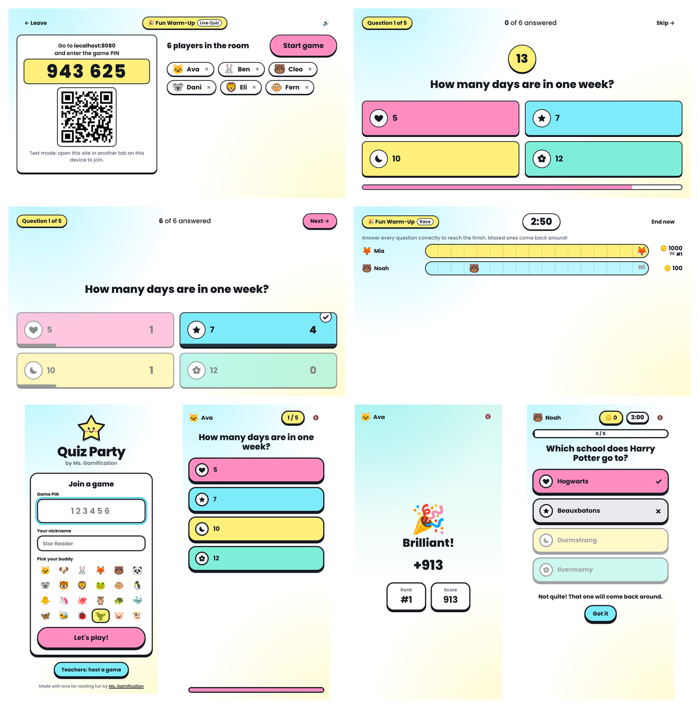

# Quiz Party

A live classroom quiz game in the style of Kahoot, Gimkit and Blooket. Kids join with a PIN on any
device, answer on their own screen, and watch the leaderboard on the big screen.



It is a plain static website. No accounts, no database, no server to run, and nothing is stored
about students. It can live for free on GitHub Pages.

## Two ways to play

| Mode | How it works |
| --- | --- |
| **Live Quiz** | Everyone answers the same question at the same time while the teacher's screen leads. Faster correct answers earn more points, and streaks add bonus points. Leaderboard after each question, podium at the end. |
| **Race** | Everyone plays at their own speed and races to the finish line. Wrong answers come back around later, so kids get a second try. Coins for correct answers, streak bonuses, and bonuses for the first three to finish. |

Also included: five starter ELA quizzes (grades 3 to 5), a quiz maker, import and export of quizzes,
QR code joining, kick button, results download (CSV), and rejoin if a student refreshes the page.

## Put it on GitHub Pages

1. Create a new repository on GitHub and upload everything in this folder to it.
2. In the repository, go to **Settings > Pages**.
3. Under **Build and deployment**, choose **Deploy from a branch**, pick **main** and **/ (root)**, then Save.
4. After a minute your site is live at `https://YOUR-USERNAME.github.io/YOUR-REPO/`.

## Running a game

1. Open your site on the computer connected to the projector and tap **Teachers: host a game**.
2. Pick a quiz, pick a mode, tap **Open game room**.
3. Students open the site (or scan the QR code), type the PIN and a nickname, and they appear on screen.
4. Tap **Start game**. In Live Quiz, Space or Enter moves to the next screen.

**Keep the teacher's tab open.** The teacher's browser is the game server. If it is closed or
refreshed, the game ends. A warning pops up if you try to leave mid game.

## Make your own quizzes

Tap **+ New quiz** in the teacher menu. Write a question, fill in 2 to 4 answers, tap the circle
next to the right one. Quizzes are saved in that browser only, so use **Export** to keep a copy
or to move a quiz to another computer, and **Import** to bring it back.

A quiz file looks like this:

```json
{
  "title": "My Quiz",
  "emoji": "⭐",
  "questions": [
    { "text": "Which word is a noun?", "options": ["run", "puppy", "quickly"], "correct": 1, "time": 20 }
  ]
}
```

`correct` counts from 0 (the first answer is 0). `time` is seconds, from 5 to 120.

## How the live connection works (and one thing to know)

Players connect straight to the teacher's browser using WebRTC through [PeerJS](https://peerjs.com).
A small "broker" server only helps them find each other at the start. By default this site uses
the **free public PeerJS broker**. That keeps setup at zero, but it is a community service with no
uptime promise, and it may limit how many people can connect at once.

If you ever see "could not connect" for everyone, or you want rock solid reliability for a big
class, run your own broker. The `server/` folder is a ready to deploy one (about ten lines).

1. Deploy `server/` to any Node host (Render, Fly.io, Railway and similar all have free tiers).
2. Add this to `index.html` above the other `<script>` tags, using your server's address:

```html
<script>
  window.QUIZ_PARTY_PEER_OPTIONS = { host: 'your-broker.onrender.com', port: 443, secure: true, path: '/' };
</script>
```

Strict school networks sometimes block WebRTC. PeerJS includes free relay servers by default
(which helps a lot), but if you set your own `config` in the options above, include relay (TURN)
servers in it too.

## Test without students

On the setup screen, tick **Test on this device only**. Open the site in a second tab to play as a
student. This works without the internet connection to the broker.

## Files

```
index.html          the page
css/style.css       all styling (Ms. Gamification brand colors, Poppins font)
js/app.js           home, join, quiz library, game setup
js/host.js          the teacher's game screens and scoring
js/player.js        the student's screens
js/editor.js        the quiz maker
js/quizzes.js       starter quizzes and quiz checking
js/transport.js     PeerJS connection (and the same-device test mode)
js/config.js        name, byline, player limit
vendor/ fonts/      PeerJS, QR code library and Poppins, bundled so nothing loads from outside
server/             optional broker
```

To change the name shown on the home screen, edit `js/config.js`.

## Scoring

- **Live Quiz:** a correct answer earns up to 1000 points. The faster the answer, the more points
  (an answer at the last second still earns 500). Each answer in a row adds a streak bonus of 100,
  up to 500.
- **Race:** 100 coins per correct answer, plus 20 extra for each correct answer in a row after the
  first (up to 100 extra). The first three to finish earn 300, 200 and 100 bonus coins.

## Privacy

Students type a nickname only. Nothing is sent to or stored on any server other than the
temporary connection through the broker. Quizzes you make stay in your own browser.
Fonts, the QR code library and PeerJS are bundled in this repository, so no student device loads
anything from a third party website.

## Credits

[PeerJS](https://peerjs.com) (MIT), [qrcode-generator](https://github.com/kazuhikoarase/qrcode-generator) (MIT),
[Poppins](https://github.com/itfoundry/poppins) font (SIL Open Font License). License details are in `vendor/` and `fonts/`.
